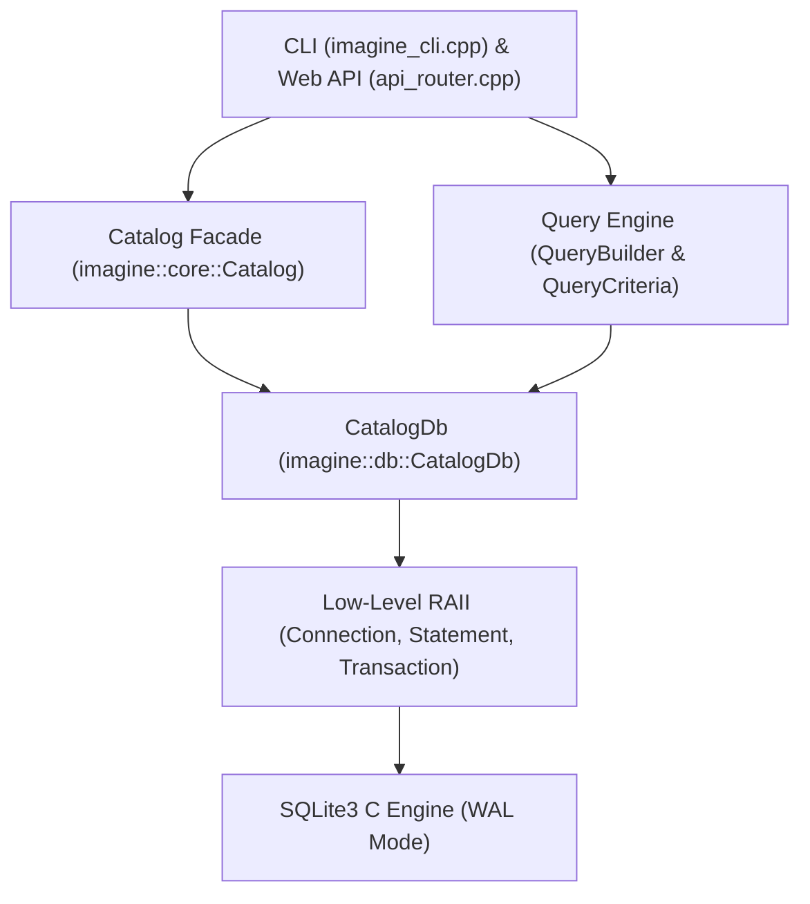

# Database Schema & Data Layer — Developer Documentation

This document provides a comprehensive technical reference for the **Imagine** database schema, storage engine configuration, migration system, index strategies, and C++ data access layer.

---

## 1. Storage Engine Architecture & SQLite Pragmas

Imagine utilizes an embedded **SQLite 3** relational database engine managed via custom C++20 RAII wrappers. The database file defaults to `catalog.db` in the working directory (configurable via `--catalog <path>`) or `:memory:` during automated unit and integration tests.

### Engine Configuration & Pragmas

When a database connection is opened in [`Connection::open`](file:///C:/Users/slava/source/repos/imagine/src/db/connection.cpp#L144-L171), SQLite is configured with specific runtime PRAGMAs to optimize concurrency, throughput, and relational integrity:

| PRAGMA | Value | Rationale & Architectural Impact |
|---|---|---|
| `journal_mode` | `WAL` | **Write-Ahead Logging** enables concurrent readers without locking during write transactions. Readers do not block writers, and writers do not block readers. |
| `synchronous` | `NORMAL` | In WAL mode, `NORMAL` ensures ACID safety while syncing the WAL file only at checkpoints, drastically reducing disk I/O latency during bulk imports. |
| `foreign_keys` | `ON` | Enforces relational constraints (such as `ON DELETE CASCADE` and `ON DELETE SET NULL`) at the SQLite engine level. |
| `temp_store` | `MEMORY` | Directs SQLite temporary tables, scratch indices, and sorting buffers to RAM rather than disk. |
| `cache_size` | `-64000` | Allocates a 64 MB page cache in memory (negative values specify size in kibibytes), accelerating frequent index and timeline lookups. |

### Thread Safety & Concurrency Model

- SQLite connection flags: `SQLITE_OPEN_READWRITE | SQLITE_OPEN_CREATE | SQLITE_OPEN_FULLMUTEX`.
- In C++, all public member functions in [`CatalogDb`](file:///C:/Users/slava/source/repos/imagine/include/imagine/db/catalog_db.hpp#L15-L86) synchronize access via an internal `std::recursive_mutex mutex_`.
- Combined with SQLite WAL mode, this provides safe multi-threaded query execution across the HTTP thread pool and background importer pipelines.

---

## 2. Entity-Relationship Diagram (ERD)

```mermaid
erDiagram
    schema_version {
        INTEGER version PK "Schema version number (1..8)"
    }

    media_items {
        INTEGER id PK "Auto-increment primary key"
        TEXT file_path UK "Unique canonical or relative path"
        TEXT file_name "Base file name"
        INTEGER file_size "Size in bytes"
        INTEGER file_modified_time "Unix timestamp (sec)"
        TEXT content_hash "Cryptographic SHA-256 hash"
        INTEGER width "Pixel width"
        INTEGER height "Pixel height"
        INTEGER date_taken "Unix timestamp (sec)"
        TEXT date_taken_str "Human readable ISO-like EXIF date"
        INTEGER rating "Rating (0 to 5 stars)"
        INTEGER flag "Cull flag (-1=Reject, 0=Unflagged, 1=Pick)"
        TEXT camera_make "EXIF camera manufacturer"
        TEXT camera_model "EXIF camera model"
        TEXT lens "EXIF lens description"
        REAL exposure_time "Shutter speed in seconds"
        REAL f_number "Aperture F-number"
        INTEGER iso "ISO speed rating"
        REAL focal_length "Focal length in mm"
        INTEGER orientation "EXIF orientation flag (1..8)"
        INTEGER has_gps "Boolean flag (0 or 1)"
        REAL latitude "GPS latitude (-90.0 to 90.0)"
        REAL longitude "GPS longitude (-180.0 to 180.0)"
        REAL altitude "GPS altitude in meters"
        TEXT thumb_small "Relative path to 256px JPEG thumbnail"
        TEXT thumb_large "Relative path to 1024px JPEG preview"
        INTEGER created_at "Catalog addition timestamp"
        INTEGER updated_at "Last metadata update timestamp"
        TEXT caption "Freeform text caption/description"
        TEXT media_type "Media kind: photo, video, or audio"
        REAL duration "Play duration in seconds"
        TEXT audio_artist "Audio artist tag"
        TEXT audio_title "Audio track title"
        TEXT audio_album "Audio album title"
        TEXT audio_genre "Audio genre tag"
        TEXT codec "Audio/video stream codec"
        INTEGER bitrate "Bitrate in bps"
        INTEGER channels "Audio channel count"
        INTEGER sample_rate "Audio sampling rate in Hz"
    }

    tags {
        INTEGER id PK "Auto-increment primary key"
        TEXT name "Tag label"
        TEXT category "Category (people, places, events, keyword)"
        INTEGER parent_id FK "Parent tag for hierarchical taxonomies"
    }

    media_tags {
        INTEGER media_id PK,FK "References media_items(id) ON DELETE CASCADE"
        INTEGER tag_id PK,FK "References tags(id) ON DELETE CASCADE"
    }

    albums {
        INTEGER id PK "Auto-increment primary key"
        TEXT name UK "Unique album title"
        TEXT description "Optional album notes"
        INTEGER is_smart "Boolean flag: 1 for smart album, 0 for manual"
        TEXT query_json "Serialized QueryCriteria for smart albums"
        INTEGER cover_media_id FK "References media_items(id) ON DELETE SET NULL"
        INTEGER created_at "Album creation timestamp"
    }

    album_media {
        INTEGER album_id PK,FK "References albums(id) ON DELETE CASCADE"
        INTEGER media_id PK,FK "References media_items(id) ON DELETE CASCADE"
        INTEGER position "Manual display sort order"
    }

    media_tag_provenance {
        INTEGER media_id PK,FK "References media_items(id) ON DELETE CASCADE"
        INTEGER tag_id PK,FK "References tags(id) ON DELETE CASCADE"
        INTEGER manual "Boolean flag: 1 for user manual, 0 for automated"
        TEXT source "Provenance origin: manual, face, or clip"
    }

    smart_tag_state {
        INTEGER media_id PK,FK "References media_items(id) ON DELETE CASCADE"
        TEXT content_hash "Cryptographic SHA-256 at time of labeling"
        TEXT model_id "CLIP model identifier"
        TEXT model_revision "CLIP model revision"
        TEXT taxonomy_version "Taxonomy version hash"
        INTEGER label_count "Count of active smart tags assigned"
        INTEGER updated_at "Unix epoch timestamp of last labeling"
    }

    smart_tag_rejections {
        INTEGER media_id PK,FK "References media_items(id) ON DELETE CASCADE"
        INTEGER tag_id PK,FK "References tags(id) ON DELETE CASCADE"
        INTEGER rejected_at "Unix epoch timestamp when user removed tag"
    }

    semantic_jobs {
        INTEGER id PK "Auto-increment primary key"
        TEXT state "Job state: running, completed, cancelled, failed"
        TEXT scope "Job scope: catalog or selected"
        TEXT model_id "Model ID associated with job"
        TEXT kind "Job kind: index or tags"
        INTEGER total "Total items in scope"
        INTEGER processed "Successfully processed count"
        INTEGER skipped "Skipped items count"
        INTEGER failed "Failed items count"
        INTEGER remaining "Remaining items count"
        TEXT error "Failure error message"
        INTEGER created_at "Job creation timestamp"
        INTEGER updated_at "Last progress update timestamp"
    }

    semantic_index_state {
        INTEGER media_id PK,FK "References media_items(id) ON DELETE CASCADE"
        TEXT content_hash "Content hash when indexed"
        TEXT model_id "CLIP model identifier"
        TEXT model_revision "CLIP model revision"
        TEXT preprocess_id "Preprocessing profile ID"
        INTEGER vector_dim "Vector embedding dimension"
        BLOB embedding "L2-normalized float32 vector embedding"
        INTEGER indexed_at "Unix epoch timestamp when indexed"
        TEXT error_text "Error message if indexing failed"
    }

    media_items ||--o{ media_tags : "tagged with"
    tags ||--o{ media_tags : "categorizes"
    tags ||--o{ tags : "parent of (hierarchical)"
    albums ||--o{ album_media : "contains"
    media_items ||--o{ album_media : "placed in"
    media_items ||--o| albums : "serves as cover for"
    media_items ||--o{ media_tag_provenance : "tracks ownership"
    tags ||--o{ media_tag_provenance : "provenance for"
    media_items ||--o| smart_tag_state : "auto-tag state"
    media_items ||--o{ smart_tag_rejections : "user rejected"
    tags ||--o{ smart_tag_rejections : "rejected tag"
    media_items ||--o| semantic_index_state : "vector indexed"
```



---

## 3. Detailed Table Specifications

### 3.1 `schema_version`

Stores the applied database migration version level.

| Column | SQLite Type | Constraints | C++ Type | Description |
|---|---|---|---|---|
| `version` | `INTEGER` | `PRIMARY KEY` | `int` | Integer migration counter (`1` through `8`). The maximum value represents the current database schema version. |

---

### 3.2 `media_items`

The central catalog table containing all imported media assets (photos, videos, audio), cryptographic hash signatures, EXIF camera metadata, ratings, cull flags, geotags, and cached thumbnail paths.

| # | Column | SQLite Type | Constraints | C++ Mapping | Description |
|---|---|---|---|---|---|
| 1 | `id` | `INTEGER` | `PRIMARY KEY AUTOINCREMENT` | `MediaId` (`int64_t`) | Unique media record identifier. |
| 2 | `file_path` | `TEXT` | `UNIQUE NOT NULL` | `std::string` | Absolute or catalog-relative path to original file on disk. |
| 3 | `file_name` | `TEXT` | `NOT NULL` | `std::string` | Base file name including extension (e.g., `mountain.jpg`). |
| 4 | `file_size` | `INTEGER` | `NOT NULL` | `int64_t` | File size in bytes. |
| 5 | `file_modified_time` | `INTEGER` | `NOT NULL` | `int64_t` | Filesystem modification time (Unix epoch in seconds). |
| 6 | `content_hash` | `TEXT` | `NOT NULL` | `std::string` | Hex-encoded cryptographic SHA-256 content hash for deduplication. |
| 7 | `width` | `INTEGER` | `DEFAULT 0` | `int32_t` | Pixel width (0 if audio or unavailable). |
| 8 | `height` | `INTEGER` | `DEFAULT 0` | `int32_t` | Pixel height (0 if audio or unavailable). |
| 9 | `date_taken` | `INTEGER` | `NOT NULL` | `int64_t` | Capture date / timestamp (Unix epoch in seconds). Falls back to modification time if absent. |
| 10 | `date_taken_str` | `TEXT` | `DEFAULT ''` | `std::string` | Original ISO-8601 or EXIF format date string (`YYYY:MM:DD HH:MM:SS`). |
| 11 | `rating` | `INTEGER` | `DEFAULT 0` | `int32_t` | User star rating: `0` (unrated) to `5` (five stars). |
| 12 | `flag` | `INTEGER` | `DEFAULT 0` | `FlagState` (`int8_t`) | Cull flag: `-1` (Reject), `0` (Unflagged), `1` (Pick). |
| 13 | `camera_make` | `TEXT` | `DEFAULT ''` | `std::string` | EXIF camera manufacturer (e.g., `Sony`, `Canon`, `Apple`). |
| 14 | `camera_model` | `TEXT` | `DEFAULT ''` | `std::string` | EXIF camera model (e.g., `ILCE-7M4`, `EOS R5`). |
| 15 | `lens` | `TEXT` | `DEFAULT ''` | `std::string` | Lens model description (e.g., `FE 24-70mm F2.8 GM II`). |
| 16 | `exposure_time` | `REAL` | `DEFAULT 0.0` | `double` | Shutter exposure duration in seconds (e.g., `0.004` for 1/250s). |
| 17 | `f_number` | `REAL` | `DEFAULT 0.0` | `double` | Lens aperture value (e.g., `2.8`). |
| 18 | `iso` | `INTEGER` | `DEFAULT 0` | `int32_t` | ISO sensitivity setting (e.g., `100`, `3200`). |
| 19 | `focal_length` | `REAL` | `DEFAULT 0.0` | `double` | Lens focal length in millimeters (e.g., `50.0`). |
| 20 | `orientation` | `INTEGER` | `DEFAULT 1` | `int32_t` | Standard EXIF orientation tag value (`1` to `8`). |
| 21 | `has_gps` | `INTEGER` | `DEFAULT 0` | `bool` | Flag indicating whether valid geographic coordinates exist (`1` = yes, `0` = no). |
| 22 | `latitude` | `REAL` | `DEFAULT 0.0` | `double` | WGS-84 latitude in decimal degrees (`-90.0` to `90.0`). |
| 23 | `longitude` | `REAL` | `DEFAULT 0.0` | `double` | WGS-84 longitude in decimal degrees (`-180.0` to `180.0`). |
| 24 | `altitude` | `REAL` | `DEFAULT 0.0` | `double` | Altitude in meters above sea level. |
| 25 | `thumb_small` | `TEXT` | `DEFAULT ''` | `std::string` | Relative path to 256px small thumbnail in cache (e.g., `34/2a/342a..._256.jpg`). |
| 26 | `thumb_large` | `TEXT` | `DEFAULT ''` | `std::string` | Relative path to 1024px preview in cache (e.g., `34/2a/342a..._1024.jpg`). |
| 27 | `created_at` | `INTEGER` | `NOT NULL` | `int64_t` | Timestamp when record was added to catalog (Unix epoch in seconds). |
| 28 | `updated_at` | `INTEGER` | `NOT NULL` | `int64_t` | Timestamp when record metadata was last altered (Unix epoch in seconds). |
| 29 | `caption` | `TEXT` | `DEFAULT ''` | `std::string` | User-defined or IPTC/XMP caption / notes (added in migration v2). |
| 30 | `media_type` | `TEXT` | `DEFAULT 'photo'` | `std::string` | Asset classification: `'photo'`, `'video'`, or `'audio'` (added in migration v3). |
| 31 | `duration` | `REAL` | `DEFAULT 0.0` | `double` | Total playback duration in seconds (added in migration v3). |
| 32 | `audio_artist` | `TEXT` | `DEFAULT ''` | `std::string` | ID3 / Vorbis audio artist tag (added in migration v3). |
| 33 | `audio_title` | `TEXT` | `DEFAULT ''` | `std::string` | ID3 / Vorbis audio title tag (added in migration v3). |
| 34 | `audio_album` | `TEXT` | `DEFAULT ''` | `std::string` | ID3 / Vorbis audio album tag (added in migration v3). |
| 35 | `audio_genre` | `TEXT` | `DEFAULT ''` | `std::string` | ID3 / Vorbis audio genre tag (added in migration v3). |
| 36 | `codec` | `TEXT` | `DEFAULT ''` | `std::string` | Audio/video format codec identifier (added in migration v3). |
| 37 | `bitrate` | `INTEGER` | `DEFAULT 0` | `int32_t` | Stream bitrate in bits per second (added in migration v3). |
| 38 | `channels` | `INTEGER` | `DEFAULT 0` | `int32_t` | Audio channel count (e.g., 1=mono, 2=stereo) (added in migration v3). |
| 39 | `sample_rate` | `INTEGER` | `DEFAULT 0` | `int32_t` | Audio sampling frequency in Hertz (e.g., 44100, 48000) (added in migration v3). |

---

### 3.3 `tags`

Stores organizational tags arranged into categories (`people`, `places`, `events`, `keyword`) and supports hierarchical nesting via self-referential foreign keys.

| Column | SQLite Type | Constraints | C++ Mapping | Description |
|---|---|---|---|---|
| `id` | `INTEGER` | `PRIMARY KEY AUTOINCREMENT` | `TagId` (`int64_t`) | Unique tag identifier. |
| `name` | `TEXT` | `NOT NULL` | `std::string` | Tag display name (e.g., `Paris`, `Alice`, `Vacation 2026`). |
| `category` | `TEXT` | `NOT NULL DEFAULT 'keyword'` | `std::string` | Category grouping: `'keyword'`, `'people'`, `'places'`, or `'events'`. |
| `parent_id` | `INTEGER` | `REFERENCES tags(id) ON DELETE SET NULL` | `std::optional<TagId>` | Optional parent tag ID for nested tag taxonomies. |

- **Compound Constraint**: `UNIQUE(name, category)` ensures that tag names are unique within each category.

---

### 3.4 `media_tags`

Junction table implementing many-to-many relationships between `media_items` and `tags`.

| Column | SQLite Type | Constraints | C++ Mapping | Description |
|---|---|---|---|---|
| `media_id` | `INTEGER` | `NOT NULL REFERENCES media_items(id) ON DELETE CASCADE` | `MediaId` (`int64_t`) | Targeted media item ID. |
| `tag_id` | `INTEGER` | `NOT NULL REFERENCES tags(id) ON DELETE CASCADE` | `TagId` (`int64_t`) | Attached tag ID. |

- **Compound Primary Key**: `PRIMARY KEY(media_id, tag_id)` prevents duplicate tag assignments to the same item.
- **Cascading Deletion**: Deleting a photo automatically detaches its tags; deleting a tag unlinks it from all media without deleting the media items.

---

### 3.5 `albums`

Stores manual collections and dynamic "smart" albums.

| Column | SQLite Type | Constraints | C++ Mapping | Description |
|---|---|---|---|---|
| `id` | `INTEGER` | `PRIMARY KEY AUTOINCREMENT` | `AlbumId` (`int64_t`) | Unique album identifier. |
| `name` | `TEXT` | `NOT NULL UNIQUE` | `std::string` | Unique album title. |
| `description` | `TEXT` | `DEFAULT ''` | `std::string` | Optional markdown or text description. |
| `is_smart` | `INTEGER` | `DEFAULT 0` | `bool` | `1` if this is a smart query-based album, `0` for manual collection. |
| `query_json` | `TEXT` | `DEFAULT ''` | `std::string` | Serialized JSON representation of [`QueryCriteria`](file:///C:/Users/slava/source/repos/imagine/include/imagine/core/query.hpp#L15-L41) executed dynamically for smart albums. |
| `cover_media_id` | `INTEGER` | `REFERENCES media_items(id) ON DELETE SET NULL` | `std::optional<MediaId>` | ID of the photo selected as the album cover preview. |
| `created_at` | `INTEGER` | `NOT NULL` | `int64_t` | Unix epoch creation timestamp. |

---

### 3.6 `album_media`

Junction table maintaining ordered membership of media items within manual albums.

| Column | SQLite Type | Constraints | C++ Mapping | Description |
|---|---|---|---|---|
| `album_id` | `INTEGER` | `NOT NULL REFERENCES albums(id) ON DELETE CASCADE` | `AlbumId` (`int64_t`) | Target album ID. |
| `media_id` | `INTEGER` | `NOT NULL REFERENCES media_items(id) ON DELETE CASCADE` | `MediaId` (`int64_t`) | Assigned media item ID. |
| `position` | `INTEGER` | `DEFAULT 0` | `int` | Custom zero-based user arrangement index for custom ordering. |

- **Compound Primary Key**: `PRIMARY KEY(album_id, media_id)` prevents duplicate insertions into an album.
- **Ordering**: Queries fetch items sorted by `album_media.position ASC, media_items.date_taken DESC`.

---

### 3.7 `media_tag_provenance`

Tracks ownership and source provenance for each media item and tag assignment (`media_tags`), distinguishing user-created manual tags from automated AI-generated tags (face recognition and CLIP smart tags). Created in migration v5 and extended in migration v8.

| Column | SQLite Type | Constraints | C++ Mapping | Description |
|---|---|---|---|---|
| `media_id` | `INTEGER` | `NOT NULL REFERENCES media_items(id) ON DELETE CASCADE` | `MediaId` (`int64_t`) | Associated media item ID. |
| `tag_id` | `INTEGER` | `NOT NULL REFERENCES tags(id) ON DELETE CASCADE` | `TagId` (`int64_t`) | Associated tag ID. |
| `manual` | `INTEGER` | `NOT NULL DEFAULT 1` | `bool` / `int` | Legacy boolean flag: `1` if user manually applied/claimed the tag, `0` if machine-generated. |
| `source` | `TEXT` | `NOT NULL DEFAULT 'manual'` | `std::string` | Added in v8. Provenance origin: `'manual'`, `'face'`, or `'clip'`. |

- **Compound Primary Key**: `PRIMARY KEY(media_id, tag_id)` mirrors `media_tags`.
- **Provenance Source Values**:
  - `'manual'`: Tag was created or explicitly confirmed by the user. Never modified by automated scanning jobs.
  - `'face'`: Tag was assigned automatically by the local InsightFace face-recognition engine.
  - `'clip'`: Tag was assigned automatically by the Smart Tags zero-shot labeling engine.

---

### 3.8 `smart_tag_state`

Tracks incremental labeling state per media item to enable fast skips on repeat runs. Added in migration v8.

| Column | SQLite Type | Constraints | C++ Mapping | Description |
|---|---|---|---|---|
| `media_id` | `INTEGER` | `PRIMARY KEY REFERENCES media_items(id) ON DELETE CASCADE` | `MediaId` (`int64_t`) | Labeled media item ID. |
| `content_hash` | `TEXT` | `NOT NULL` | `std::string` | Cryptographic SHA-256 hash of the media content at the time of labeling. |
| `model_id` | `TEXT` | `NOT NULL` | `std::string` | CLIP model identifier (e.g. `clip-vit-base-patch32`). |
| `model_revision` | `TEXT` | `NOT NULL` | `std::string` | Model revision / checkpoint identifier. |
| `taxonomy_version` | `TEXT` | `NOT NULL` | `std::string` | Hash digest representing the exact taxonomy definition and prompt version. |
| `label_count` | `INTEGER` | `NOT NULL DEFAULT 0` | `int32_t` | Count of active smart tags currently assigned to this photo. |
| `updated_at` | `INTEGER` | `NOT NULL` | `int64_t` | Unix epoch timestamp in seconds when smart tags were last computed. |

- **Incremental Skip Logic**: During a catalog tagging scan, a photo is skipped if its current `content_hash`, `model_id`, `model_revision`, and `taxonomy_version` match `smart_tag_state` (unless `force = true` is requested).
- **Cascade Behavior**: Deleting a media item cascades and removes its `smart_tag_state` row.

---

### 3.9 `smart_tag_rejections`

Maintains persistent user rejection memory. When a user manually removes an AI-generated tag (`source = 'clip'`) from a photo, a record is stored here so subsequent labeling runs will never re-assign that tag to that photo. Added in migration v8.

| Column | SQLite Type | Constraints | C++ Mapping | Description |
|---|---|---|---|---|
| `media_id` | `INTEGER` | `NOT NULL REFERENCES media_items(id) ON DELETE CASCADE` | `MediaId` (`int64_t`) | Target media item ID. |
| `tag_id` | `INTEGER` | `NOT NULL REFERENCES tags(id) ON DELETE CASCADE` | `TagId` (`int64_t`) | Rejected tag ID. |
| `rejected_at` | `INTEGER` | `NOT NULL` | `int64_t` | Unix epoch timestamp in seconds when the tag was rejected. |

- **Compound Primary Key**: `PRIMARY KEY(media_id, tag_id)` prevents duplicate rejection entries.
- **Un-rejection / Manual Claim**: If the user subsequently adds the rejected tag back to the photo manually, the matching row in `smart_tag_rejections` is deleted and the tag's provenance is promoted to `'manual'`.

---

### 3.10 `semantic_jobs`

Tracks background asynchronous indexing and tagging jobs executed by the CLIP service worker. Created in migration v7 and extended in migration v8.

| Column | SQLite Type | Constraints | C++ Mapping | Description |
|---|---|---|---|---|
| `id` | `INTEGER` | `PRIMARY KEY AUTOINCREMENT` | `int64_t` | Unique job identifier. |
| `state` | `TEXT` | `NOT NULL` | `std::string` | Job execution state: `'running'`, `'cancelling'`, `'completed'`, `'cancelled'`, `'failed'`. |
| `scope` | `TEXT` | `NOT NULL` | `std::string` | Job target scope: `'catalog'` or `'selected'`. |
| `model_id` | `TEXT` | `NOT NULL DEFAULT ''` | `std::string` | Associated CLIP model identifier. |
| `kind` | `TEXT` | `NOT NULL DEFAULT 'index'` | `std::string` | Added in v8. Job kind: `'index'` for vector search indexing, or `'tags'` for Smart Tags auto-labeling. |
| `total` | `INTEGER` | `NOT NULL DEFAULT 0` | `int32_t` | Total photos in job scope. |
| `processed` | `INTEGER` | `NOT NULL DEFAULT 0` | `int32_t` | Number of successfully processed photos. |
| `skipped` | `INTEGER` | `NOT NULL DEFAULT 0` | `int32_t` | Number of skipped photos (unchanged embeddings or previously labeled). |
| `failed` | `INTEGER` | `NOT NULL DEFAULT 0` | `int32_t` | Number of photos that failed processing. |
| `remaining` | `INTEGER` | `NOT NULL DEFAULT 0` | `int32_t` | Unprocessed photos remaining in scope. |
| `error` | `TEXT` | `NOT NULL DEFAULT ''` | `std::string` | Human-readable error description on failure. |
| `created_at` | `INTEGER` | `NOT NULL` | `int64_t` | Unix epoch timestamp when job was started. |
| `updated_at` | `INTEGER` | `NOT NULL` | `int64_t` | Unix epoch timestamp of last progress update. |

- **Single Active Job Constraint**: A unique partial index (`idx_semantic_one_active_job`) ensures that only one semantic job (`state IN ('running', 'cancelling')`) can be active at a time across indexing and tagging.
- **Kind Scoping**: `POST /api/semantic/jobs` creates `'index'` jobs; `POST /api/smart-tags/jobs` creates `'tags'` jobs. Route handlers enforce kind filtering so tags jobs are not accessible via search indexing endpoints.

---

### 3.11 `semantic_index_state` & `semantic_models`

Stores pre-computed CLIP vector embeddings and model metadata. Added in migration v7.

#### `semantic_index_state`
| Column | SQLite Type | Constraints | C++ Mapping | Description |
|---|---|---|---|---|
| `media_id` | `INTEGER` | `PRIMARY KEY REFERENCES media_items(id) ON DELETE CASCADE` | `MediaId` (`int64_t`) | Associated media item ID. |
| `content_hash` | `TEXT` | `NOT NULL` | `std::string` | SHA-256 hash of media file when embedding was generated. |
| `model_id` | `TEXT` | `NOT NULL` | `std::string` | CLIP model ID. |
| `model_revision` | `TEXT` | `NOT NULL` | `std::string` | CLIP model revision. |
| `preprocess_id` | `TEXT` | `NOT NULL` | `std::string` | Preprocessing configuration hash. |
| `vector_dim` | `INTEGER` | `NOT NULL` | `int32_t` | Embedding vector dimension (e.g. 512). |
| `embedding` | `BLOB` | *(nullable)* | `std::vector<float>` | Binary raw float32 L2-normalized embedding vector. |
| `indexed_at` | `INTEGER` | `NOT NULL` | `int64_t` | Unix timestamp when indexed. |
| `error_text` | `TEXT` | `DEFAULT ''` | `std::string` | Error message if extraction failed. |

#### `semantic_models`
Stores installed model checkpoints, vector dimensions, and tokenizer configurations. Keyed by `model_id` (`TEXT PRIMARY KEY`).

---

### 3.12 Face Recognition Tables

Added in migration v5 and v6 to support InsightFace SCRFD face detection and ArcFace identity recognition:
- **`faces`**: Individual detected face bounding boxes (`x, y, width, height`), 5 landmarks, ArcFace 512-dim embedding BLOB, assigned `person_tag_id` (`REFERENCES tags(id)`), and dismissal status.
- **`face_rejections`**: `(face_id, tag_id)` rejections preventing discarded suggestions from reappearing.
- **`face_media_analysis`**: Per-photo analysis state, detector/recognizer checksums, and execution provider metrics.
- **`face_analysis_jobs`** & **`face_analysis_job_media`**: Background job queue, progress counters, and selected media scope tracking.

---

## 4. Comprehensive Index Catalog

The database includes specialized B-Tree indices designed to ensure sub-millisecond query latency across millions of assets:

| Index Name | Table | Indexed Columns | Index Type | Query Optimization Purpose |
|---|---|---|---|---|
| `sqlite_autoindex_media_items_1` | `media_items` | `file_path` | Implicit Unique | Enforces path uniqueness and powers fast exact-path lookup in [`getMediaByPath`](file:///C:/Users/slava/source/repos/imagine/src/db/catalog_db.cpp#L480-L492). |
| `idx_media_hash` | `media_items` | `content_hash` | Secondary B-Tree | Powers instant deduplication checks during importer scans in [`getMediaByHash`](file:///C:/Users/slava/source/repos/imagine/src/db/catalog_db.cpp#L493-L504). |
| `idx_media_date` | `media_items` | `date_taken DESC` | Secondary B-Tree (Descending) | Optimizes default chronological media grid rendering and timeline histogram grouping queries. |
| `idx_media_rating` | `media_items` | `rating` | Secondary B-Tree | Speeds up star-rating culling filters (`rating >= ?`, unrated filters). |
| `idx_media_flag` | `media_items` | `flag` | Secondary B-Tree | Accelerates quick-filter queries for Picks (`flag = 1`), Rejects (`flag = -1`), and non-rejects. |
| `idx_media_camera` | `media_items` | `camera_make, camera_model` | Composite B-Tree | Speeds up multi-camera filtering and metadata search matching equipment models. |
| `idx_media_caption` | `media_items` | `caption` | Secondary B-Tree | Added in v2. Accelerates caption-specific search and text filtering. |
| `idx_media_type` | `media_items` | `media_type` | Secondary B-Tree | Added in v3. Optimizes type filtering (photos vs. videos vs. audio tracks). |
| `sqlite_autoindex_tags_1` | `tags` | `name, category` | Implicit Unique | Enforces uniqueness per category and powers [`createOrGetTag`](file:///C:/Users/slava/source/repos/imagine/src/db/catalog_db.cpp#L600-L623). |
| `idx_tags_category` | `tags` | `category` | Secondary B-Tree | Speeds up sidebar tag listing grouped by `category` (people, places, events, keywords). |
| `sqlite_autoindex_media_tags_1` | `media_tags` | `media_id, tag_id` | Implicit Primary Key | Speeds up forward lookups (fetching all tags for a given media item or batch). |
| `idx_media_tags_tag` | `media_tags` | `tag_id` | Secondary B-Tree | Enables efficient reverse lookups (finding all media items with a specific tag). |
| `sqlite_autoindex_albums_1` | `albums` | `name` | Implicit Unique | Enforces unique album titles and powers name lookups. |
| `sqlite_autoindex_album_media_1` | `album_media` | `album_id, media_id` | Implicit Primary Key | Accelerates album membership lookups and updates. |
| `idx_album_media_media` | `album_media` | `media_id` | Secondary B-Tree | Enables efficient reverse lookups (determining which albums contain a given photo). |
| `idx_media_tag_provenance_source` | `media_tag_provenance` | `source, media_id` | Composite B-Tree | Added in v8. Optimizes provenance queries, filtering by origin (`clip`, `manual`, `face`), and batch clearing of AI tags. |
| `idx_semantic_jobs_kind` | `semantic_jobs` | `kind, state` | Composite B-Tree | Added in v8. Speeds up job lookups partitioned by job kind (`index` vs. `tags`) and active state. |
| `idx_smart_tag_state_lookup` | `smart_tag_state` | `model_id, model_revision, taxonomy_version, content_hash` | Composite B-Tree | Added in v8. Optimizes incremental skip lookups and labeled photo counting without full table scans. |
| `sqlite_autoindex_smart_tag_rejections_1` | `smart_tag_rejections` | `media_id, tag_id` | Implicit Primary Key | Added in v8. Guarantees $O(1)$ rejection lookups during candidate scoring. |
| `idx_semantic_state_model` | `semantic_index_state` | `model_id, model_revision` | Composite B-Tree | Added in v7. Optimizes embedding vector queries scoped to the currently active CLIP model checkpoint. |
| `idx_semantic_one_active_job` | `semantic_jobs` | `(1)` | Partial Unique | Added in v7. Enforces at most one active indexing or smart-tagging job in `running` or `cancelling` state. |
| `idx_media_tag_provenance_tag` | `media_tag_provenance` | `tag_id, manual` | Composite B-Tree | Added in v5. Speeds up tag provenance resolution and category counts. |
| `idx_faces_media` | `faces` | `media_id, id` | Composite B-Tree | Added in v5. Optimizes fetching all detected face crops for a photo. |
| `idx_faces_person` | `faces` | `person_tag_id, dismissed` | Composite B-Tree | Added in v5. Accelerates person cluster grouping and unconfirmed face suggestions. |
| `idx_face_rejections_tag` | `face_rejections` | `tag_id` | Secondary B-Tree | Added in v5. Accelerates identity suggestion filtering. |
| `idx_face_one_active_job` | `face_analysis_jobs` | `(1)` | Partial Unique | Added in v5. Enforces at most one active face analysis job. |
| `idx_face_job_media_media` | `face_analysis_job_media` | `media_id` | Secondary B-Tree | Added in v6. Optimizes face scan job photo scope lookups. |

---

## 5. Schema Migrations Architecture

Database migrations are managed programmatically in [`include/imagine/db/schema.hpp`](file:///C:/Users/slava/source/repos/imagine/include/imagine/db/schema.hpp) and [`src/db/schema.cpp`](file:///C:/Users/slava/source/repos/imagine/src/db/schema.cpp).

### Migration Runner Lifecycle

When [`CatalogDb::open`](file:///C:/Users/slava/source/repos/imagine/src/db/catalog_db.cpp#L20-L25) is called:
1. It opens the database file and configures SQLite PRAGMAs.
2. It invokes [`Schema::migrate(conn)`](file:///C:/Users/slava/source/repos/imagine/src/db/schema.cpp#L214-L248).
3. [`Schema::getCurrentVersion`](file:///C:/Users/slava/source/repos/imagine/src/db/schema.cpp#L6-L22) queries `SELECT MAX(version) FROM schema_version`. If `schema_version` does not exist, it creates the table and returns `0`.
4. Sequentially executes any unapplied migration methods (`applyMigrationV1`, `applyMigrationV2`, etc.) inside individual atomic [`Transaction`](file:///C:/Users/slava/source/repos/imagine/include/imagine/db/connection.hpp#L94-L108) blocks.
5. Inserts the newly achieved version number into `schema_version` and commits.

### Migration History

#### Version 1 (Baseline)
- Creates base tables: `media_items`, `tags`, `media_tags`, `albums`, `album_media`.
- Creates core B-Tree indices: `idx_media_hash`, `idx_media_date`, `idx_media_rating`, `idx_media_flag`, `idx_media_camera`, `idx_tags_category`, `idx_media_tags_tag`, `idx_album_media_media`.
- Records version `1` in `schema_version`.

#### Version 2 (Captions)
- Executes:
  ```sql
  ALTER TABLE media_items ADD COLUMN caption TEXT DEFAULT '';
  CREATE INDEX IF NOT EXISTS idx_media_caption ON media_items(caption);
  ```
- Records version `2` in `schema_version`.

#### Version 3 (Audio & Video Formats)
- Expands `media_items` to support multimedia cataloging (videos, audio recordings):
  ```sql
  ALTER TABLE media_items ADD COLUMN media_type TEXT DEFAULT 'photo';
  ALTER TABLE media_items ADD COLUMN duration REAL DEFAULT 0.0;
  ALTER TABLE media_items ADD COLUMN audio_artist TEXT DEFAULT '';
  ALTER TABLE media_items ADD COLUMN audio_title TEXT DEFAULT '';
  ALTER TABLE media_items ADD COLUMN audio_album TEXT DEFAULT '';
  ALTER TABLE media_items ADD COLUMN audio_genre TEXT DEFAULT '';
  ALTER TABLE media_items ADD COLUMN codec TEXT DEFAULT '';
  ALTER TABLE media_items ADD COLUMN bitrate INTEGER DEFAULT 0;
  ALTER TABLE media_items ADD COLUMN channels INTEGER DEFAULT 0;
  ALTER TABLE media_items ADD COLUMN sample_rate INTEGER DEFAULT 0;
  CREATE INDEX IF NOT EXISTS idx_media_type ON media_items(media_type);
  ```
- Records version `3` in `schema_version`.

#### Version 4 (Data Backfill for Media Types & Thumbnails)
- Performs data migration to classify legacy imports:
  - Detects video extensions (`.mp4`, `.mov`, `.avi`, `.mkv`, `.webm`, `.m4v`, `.mts`, `.m2ts`, `.m2t`, `.mpg`, `.mpeg`, `.wmv`, `.flv`, `.3gp`) and updates `media_type = 'video'`.
  - Detects audio extensions (`.mp3`, `.wav`, `.flac`, `.ogg`, `.m4a`, `.aac`, `.wma`) and updates `media_type = 'audio'`.
  - Generates standardized hash-based thumbnail paths (`substr(content_hash, 1, 2) || '/' || substr(content_hash, 3, 2) || '/' || content_hash || '_256.jpg'` and `_1024.jpg`) for video and audio entries with missing thumbnail paths.
- Records version `4` in `schema_version`.

#### Version 5 (Face Detection & Recognition Pipeline)
- Adds face analysis jobs, face detections, identity clusters, and tag provenance:
  - `face_analysis_jobs`: Asynchronous scan job state, scope, and progress counters.
  - `idx_face_one_active_job`: Partial unique index enforcing at most one active face scan.
  - `face_media_analysis`: Per-photo detection status, detector/recognizer checksums, and execution provider metrics.
  - `faces`: Detected face crops, landmarks, ArcFace 512-dim embedding BLOBs, and person tag IDs.
  - `face_rejections`: Discarded face identity suggestions.
  - `media_tag_provenance`: Initializes tag ownership tracking with `manual` flag (`1` for manual, `0` for automated); backfills existing `media_tags` with `manual = 1`.
- Records version `5` in `schema_version`.

#### Version 6 (Face Analysis Job Scoping)
- Adds `face_analysis_job_media` to associate specific media items with targeted face scan jobs.
- Creates index `idx_face_job_media_media`.
- Records version `6` in `schema_version`.

#### Version 7 (CLIP Semantic AI Search Engine)
- Adds vector search models, embeddings state, and background indexing jobs:
  - `semantic_models`: Installed CLIP checkpoints, vector dimensions, and tokenizer configurations.
  - `semantic_index_state`: Normalized 512-dimensional float32 vector embeddings and content hashes.
  - `idx_semantic_state_model`: B-Tree index on `(model_id, model_revision)`.
  - `semantic_jobs`: Background vector indexing job tracking.
  - `idx_semantic_one_active_job`: Partial unique index enforcing at most one active indexing job.
- Records version `7` in `schema_version`.

#### Version 8 (Smart Tags & Provenance Source)
- Adds support for local zero-shot auto-labeling, intelligent rejection memory, and fine-grained tag provenance:
  ```sql
  ALTER TABLE media_tag_provenance ADD COLUMN source TEXT NOT NULL DEFAULT 'manual';
  UPDATE media_tag_provenance SET source = 'face' WHERE manual = 0;
  CREATE INDEX IF NOT EXISTS idx_media_tag_provenance_source
      ON media_tag_provenance(source, media_id);

  ALTER TABLE semantic_jobs ADD COLUMN kind TEXT NOT NULL DEFAULT 'index';
  CREATE INDEX IF NOT EXISTS idx_semantic_jobs_kind ON semantic_jobs(kind, state);

  CREATE TABLE IF NOT EXISTS smart_tag_state (
      media_id         INTEGER PRIMARY KEY REFERENCES media_items(id) ON DELETE CASCADE,
      content_hash     TEXT NOT NULL,
      model_id         TEXT NOT NULL,
      model_revision   TEXT NOT NULL,
      taxonomy_version TEXT NOT NULL,
      label_count      INTEGER NOT NULL DEFAULT 0,
      updated_at       INTEGER NOT NULL
  );
  CREATE INDEX IF NOT EXISTS idx_smart_tag_state_lookup
      ON smart_tag_state(model_id, model_revision, taxonomy_version, content_hash);

  CREATE TABLE IF NOT EXISTS smart_tag_rejections (
      media_id    INTEGER NOT NULL REFERENCES media_items(id) ON DELETE CASCADE,
      tag_id      INTEGER NOT NULL REFERENCES tags(id) ON DELETE CASCADE,
      rejected_at INTEGER NOT NULL,
      PRIMARY KEY(media_id, tag_id)
  );
  ```
- Backfills all existing automated tags (`manual = 0`) to `source = 'face'`.
- Partitions `semantic_jobs` by `kind`: `'index'` for vector indexing and `'tags'` for Smart Tags auto-labeling.
- Creates `smart_tag_state` to skip previously scored photos whose content hash and taxonomy match.
- Creates `smart_tag_rejections` to record persistent user rejections of AI labels.
- Records version `8` in `schema_version`.

### Provenance Rules & Cascade Semantics

With Schema v8, Imagine enforces strict provenance rules to ensure automated AI processes never corrupt or downgrade user-created tags, and that clearing or updating automated tags remains safe and predictable:

#### Provenance Source Values

| `source` | `manual` | Origin & Behavioral Semantics |
|---|---|---|
| `'manual'` | `1` | User-created or user-claimed assignment. Protected from automated overwrites or deletions. |
| `'face'` | `0` | Face-recognition ownership (including legacy automated rows backfilled by migration v8). |
| `'clip'` | `0` | Smart Tags zero-shot ownership. Can be regenerated or cleared in bulk without affecting manual or face tags. |

#### Operational Provenance Rules

- **`addTagToMedia(mediaId, tagId)`**:
  - Inserts into `media_tags`.
  - On conflict or insert, updates `media_tag_provenance` to `manual = 1, source = 'manual'`. If the tag was previously AI-owned, ownership is promoted to manual.
  - Automatically deletes any matching `(media_id, tag_id)` entry from `smart_tag_rejections`, un-rejecting the tag.
- **`replaceTagAssignments(mediaId, tagIds)`**:
  - Replaces all tag assignments for the media item with `manual = 1, source = 'manual'`.
  - User batch actions must never leave tags marked as `'clip'`.
  - Clears matching entries from `smart_tag_rejections`.
- **`syncFaceTagOwnership` (`src/faces/service.cpp`)**:
  - Inserts new face ownership with `manual = 0, source = 'face'`.
  - On face unassignment, deletes provenance only when `source != 'clip'`. Never deletes a `clip`-owned tag when an identity is unassigned or renamed.
- **`removeTagFromMedia(mediaId, tagId)`**:
  - Reads `source` from `media_tag_provenance`.
  - When `source = 'clip'`, automatically inserts a rejection record into `smart_tag_rejections(media_id, tag_id, rejected_at)` before deleting the tag attachment.
- **`invalidateFaceAnalysis` / Media File Changed**:
  - When an original photo's file content changes (new SHA-256 hash) or is re-imported:
  - Deletes all `manual = 0` tag attachments (covers both face and clip tags).
  - Deletes `smart_tag_state` and `smart_tag_rejections` for that `media_id`.
- **`deleteTag(tagId)`**:
  - Existing foreign key constraints (`ON DELETE CASCADE`) automatically delete all assignments in `media_tags` and rejections in `smart_tag_rejections`.
  - Leaves `smart_tag_state` intact so that an incremental scan does not immediately recreate the globally deleted tag. A forced rerun or taxonomy version change will re-evaluate and restore it if qualifying.
- **`replaceSmartTags` (`CatalogDb`)**:
  - Executed in batches during Smart Tags jobs:
    1. Deletes `media_tags` for tag IDs owned by `source = 'clip'` for that media item.
    2. Deletes those `source = 'clip'` provenance rows.
    3. Inserts new `media_tags` and `ON CONFLICT DO NOTHING` provenance rows (`manual = 0, source = 'clip'`), guaranteeing manual tag ownership is never downgraded.
    4. Upserts `smart_tag_state` with current content hash, model ID, revision, taxonomy version, and `label_count`.
- **`clearSmartTags` (`CatalogDb`)**:
  - Deletes all `media_tags` and `media_tag_provenance` records where `source = 'clip'`.
  - Truncates `smart_tag_state` and `smart_tag_rejections`.
  - Preserves all manual tags (`source = 'manual'`) and face tags (`source = 'face'`). Returns a conflict if a job is actively running.

### Adding a New Migration: Developer Checklist

1. **Increment Version Constant**: Update `static constexpr int CurrentVersion = N;` in [`include/imagine/db/schema.hpp`](file:///C:/Users/slava/source/repos/imagine/include/imagine/db/schema.hpp#L10).
2. **Declare Migration Method**: Add `static Status applyMigrationVN(Connection& conn);` under `private:` in [`include/imagine/db/schema.hpp`](file:///C:/Users/slava/source/repos/imagine/include/imagine/db/schema.hpp).
3. **Implement Migration**:
   - In [`src/db/schema.cpp`](file:///C:/Users/slava/source/repos/imagine/src/db/schema.cpp), wrap SQL in `Transaction tx(conn);`.
   - Execute DDL/DML statements.
   - Insert `INSERT INTO schema_version (version) VALUES (N);`.
   - Return `tx.commit()`.
4. **Wire into `Schema::migrate`**: Add condition:
   ```cpp
   if (current < N) {
       IMAGINE_LOG_INFO("Applying database migration vN...");
       Status s = applyMigrationVN(conn);
       if (!s.isOk()) return s;
       current = N;
   }
   ```
5. **Update C++ Structs & Accessors**: Update [`MediaItem`](file:///C:/Users/slava/source/repos/imagine/include/imagine/common/types.hpp#L135-L164), `extractMediaItem`, `insertMedia`, and `updateMedia` if new columns were added.
6. **Add Unit Tests**: Add test cases to [`tests/db_test.cpp`](file:///C:/Users/slava/source/repos/imagine/tests/db_test.cpp) verifying migration from existing database state.

---

## 6. C++ Data Access Architecture

The database subsystem uses a clean layered architecture separating low-level SQLite C-API calls from domain models and query construction:



### Key Classes

- [`Connection`](file:///C:/Users/slava/source/repos/imagine/include/imagine/db/connection.hpp#L66-L92): RAII wrapper around `sqlite3*`. Handles connection lifecycle, PRAGMA execution, and prepared statement compilation.
- [`Statement`](file:///C:/Users/slava/source/repos/imagine/include/imagine/db/connection.hpp#L21-L64): RAII wrapper around `sqlite3_stmt*`. Handles 1-indexed typed parameter binding (`bind(int, int64_t)`, `bind(int, const std::string&)`, `bindOptional`) and 0-indexed column extraction (`getInt64`, `getString`, `getDouble`, `isNull`).
- [`Transaction`](file:///C:/Users/slava/source/repos/imagine/include/imagine/db/connection.hpp#L94-L108): Automatic RAII transaction guard. Automatically rolls back via `ROLLBACK;` in destructor unless explicitly committed with `commit()`.
- [`CatalogDb`](file:///C:/Users/slava/source/repos/imagine/include/imagine/db/catalog_db.hpp#L15-L86): High-level, thread-safe data access object encapsulating all CRUD operations, batch operations, timeline histogram queries, and stats generation.
- [`QueryBuilder`](file:///C:/Users/slava/source/repos/imagine/include/imagine/core/query.hpp#L56-L99): Fluent query builder that dynamically constructs SQL `WHERE` and `ORDER BY` clauses and binds parameters to protect against SQL injection.

### Path Normalization & Portability (`makePathsRelative`)

To ensure catalogs can be moved between directories or machines without breaking media links, [`CatalogDb::makePathsRelative`](file:///C:/Users/slava/source/repos/imagine/src/db/catalog_db.cpp#L1148-L1284):
1. Accepts root `photosDir` and `thumbsDir`.
2. Computes canonical lexical relative paths using `std::filesystem::relative`.
3. Normalizes all path separators to POSIX forward slashes (`/`).
4. Updates `file_path`, `thumb_small`, and `thumb_large` in a single atomic transaction.

---

## 7. Verification & Automated Testing

The database layer and its schema migrations are covered by unit tests in [`tests/db_test.cpp`](file:///C:/Users/slava/source/repos/imagine/tests/db_test.cpp).

### Running Database Unit Tests

```bash
# Run all unit tests
./build/imagine_tests

# Run specifically database and connection tests
./build/imagine_tests --gtest_filter="*CatalogDb*:*Connection*:*Transaction*"
```

### Covered Test Areas
- In-memory database initialization and schema migration execution.
- Single and batch insertion, retrieval, updates, and deletion of media records.
- Tag creation, hierarchical tag retrieval (`parent_id`), duplicate handling, batch tag lookups, and unlinking.
- Album creation, cover image selection, manual media ordering (`position`), and cascade deletions.
- Aggregation queries: monthly timeline histogram (`getTimeline`) and catalog statistics (`getStats`).
- Geotag updates and clearance (`updateGps`).
- Path portability conversion (`makePathsRelative`).
- Low-level connection, statement binding, and transaction rollback / auto-rollback integrity.
